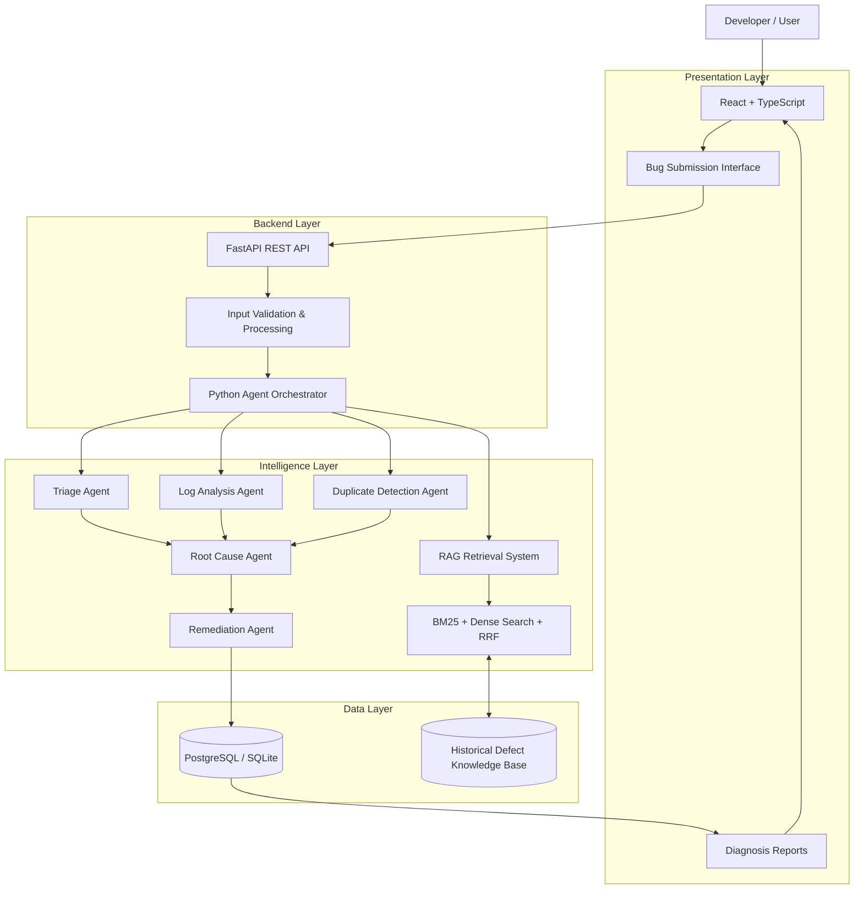

# System Architecture – TraceIQ

**Project:** TraceIQ – Intelligent Bug Diagnosis Platform  
**Version:** 1.0

## 1. Architecture Overview

TraceIQ is an intelligent bug diagnosis platform that combines a React frontend, Python backend, RAG-based retrieval and five specialised diagnostic agents.

## 2. System Architecture Diagram

## 3. Technology Stack

| Layer | Technology |
|---|---|
| Frontend | React, TypeScript, Vite, Tailwind CSS |
| Backend | Python, FastAPI |
| Database | PostgreSQL, SQLite, SQLAlchemy |
| Retrieval | BM25, Dense Search, RRF |
| Embeddings | SentenceTransformers (optional) |
| AI Orchestration | Python Agent Orchestrator |
| LLM Integration | Optional Anthropic API |
| Testing | Pytest |
| Deployment | Docker, Nginx |

## 4. Five Diagnostic Agents

1. **Triage Agent:** Classifies bugs and identifies severity.
2. **Log Analysis Agent:** Analyses error messages and stack traces.
3. **Duplicate Detection Agent:** Finds similar historical bug reports.
4. **Root Cause Agent:** Identifies possible causes of the issue.
5. **Remediation Agent:** Suggests fixes and debugging steps.

## 5. RAG Retrieval Process

The RAG system retrieves relevant historical defect information to support bug diagnosis.

1. Process the submitted bug information.
2. Search historical defects using BM25.
3. Perform dense retrieval when semantic embeddings are available.
4. Combine rankings using Reciprocal Rank Fusion (RRF).
5. Provide relevant information to the diagnostic pipeline.

## 6. System Workflow

1. User submits bug title, programming language, source code and terminal output.
2. FastAPI validates and processes the submission.
3. RAG retrieves relevant historical defects.
4. Five specialised agents analyse the issue.
5. The system generates possible root causes and fix recommendations.
6. Diagnosis results are stored in the database.
7. Results are displayed on the frontend.

## 7. Project Objective

TraceIQ aims to simplify software debugging through automated defect analysis, historical bug retrieval, specialised diagnostic agents and AI-assisted fix recommendations.

**Note:** All recommended fixes are advisory and require developer verification.
