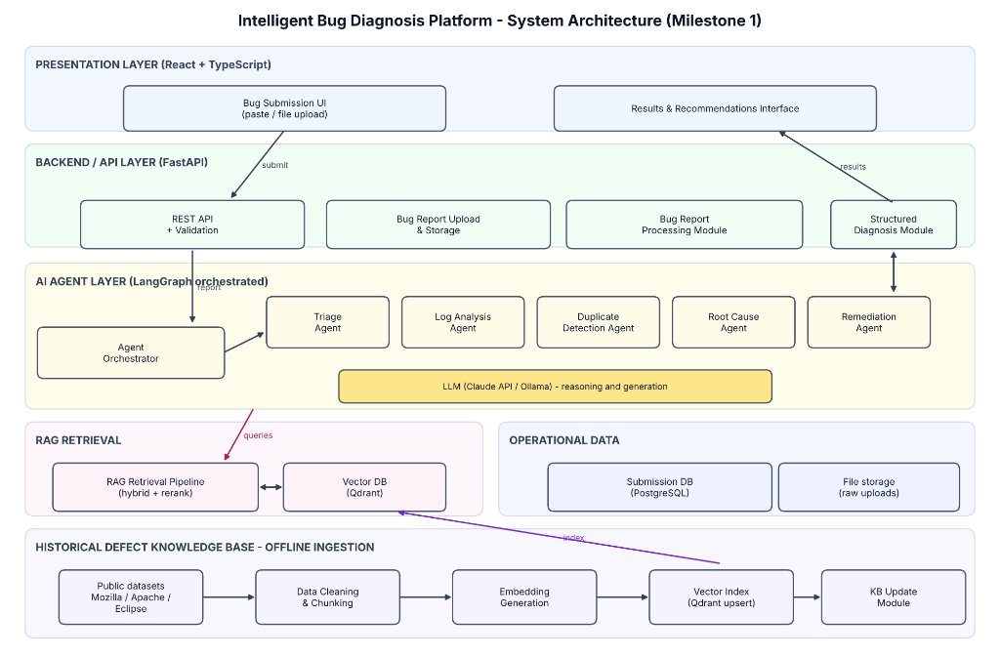
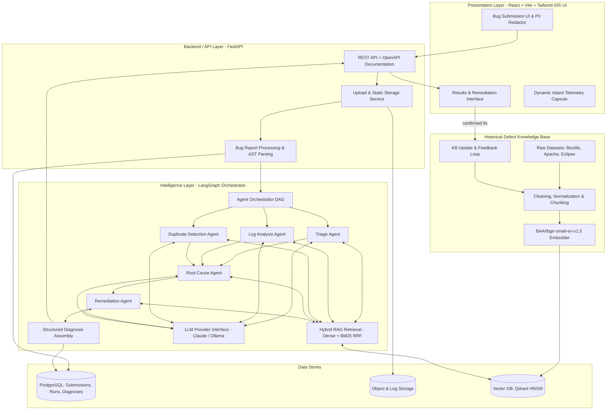

# System Architecture – TraceIQ Intelligent Bug Diagnosis Platform

**Platform:** TraceIQ  
**Version:** 1.0 (Milestone 1 Foundation + M2 Agents)  
**Date:** 13 November 2026  
**Scope:** Foundation, Bug Understanding, RAG Retrieval, and 5-Agent Pipeline.

---

## 1. Architecture Overview

TraceIQ features two complementary pipelines that meet at a shared retrieval layer:

1. **Offline Ingestion Pipeline**: Ingests, normalizes, chunks, embeds, and indexes historical defect repositories from Mozilla Bugzilla, Apache Jira, and the Eclipse Foundation into a Qdrant HNSW vector store and BM25 index.
2. **Online Diagnosis Pipeline**: Accepts a new defect report (description, stack trace, and logs), scrubs PII, retrieves similar historical defects via reciprocal rank fusion, and runs a 5-agent LangGraph pipeline to synthesize structured findings and actionable code recommendations.

### 1.1 Layered View (Mermaid)

---

## 2. Component Responsibilities

| # | Component | Responsibility | Technology |
|---|---|---|---|
| 1 | **Bug Submission Studio** | Paste stack traces, upload files, client-side PII scrubbing, 1-click preset loader | React 18, TypeScript, Tailwind CSS (iOS System Design) |
| 2 | **Backend API Layer** | Request validation, authentication hooks, file streaming, orchestration triggers | FastAPI, Pydantic v2 |
| 3 | **Upload & Storage Service** | Secure multipart file ingestion, size & MIME allowlisting, SHA-256 integrity | FastAPI, local disk / S3-compatible |
| 4 | **Report Processing Module** | Decompiles stack traces, normalizes memory hex addresses and line numbers | Python regex, AST parsers |
| 5 | **Operational Database** | Persistent relational state for submissions, attachments, agent logs, and diagnoses | PostgreSQL 16, SQLAlchemy 2, Alembic |
| 6 | **Defect Knowledge Base** | Curated source-of-truth defect lake (Mozilla Bugzilla, Eclipse, Apache Jira) | Parquet, PostgreSQL |
| 7 | **Cleaning & Chunking Pipeline** | Splits defects into typed chunks (`description`, `stack_trace`, `comment`, `resolution`) | pandas, tiktoken |
| 8 | **Embedding Module** | Maps text and query chunks into 384-dimensional dense vectors | `BAAI/bge-small-en-v1.5` via sentence-transformers |
| 9 | **Vector Database** | High-performance approximate nearest neighbor search with metadata filters | Qdrant (HNSW Graph Cosine Metric) |
| 10 | **Hybrid RAG Retriever** | Merges dense embeddings with BM25 sparse keyword scores via Reciprocal Rank Fusion | Python, `rank_bm25`, Qdrant |
| 11 | **LLM Inference Provider** | Provider-agnostic reasoning abstraction | Anthropic Claude 3.5 Sonnet / Local Ollama |
| 12 | **5-Agent Swarm** | Specialized agents with bounded prompts, deterministic state, and typed JSON schemas | LangGraph state graph |
| 13 | **Remediation Inspector** | Interactive findings viewer with code diffs, cited bug links, and export facilities | React 18 (iOS Inspector Design) |

---

## 3. The 5 Diagnostic Agents

| Agent | Input | Output Schema | RAG Retrieval? |
|---|---|---|---|
| **Triage Agent** | Normalized BugReport | Severity, Priority, Target Subsystem, Missing Information warnings | Yes — label distribution of similar defects |
| **Log Analysis Agent** | Stack traces, runtime logs | Exception type, normalized frames, suspect files, event timeline | Yes — matches crash signatures |
| **Duplicate Detection Agent** | Report summary & normalized frames | Ranked duplicate candidates with similarity scores and rationale | Yes — Core hybrid retrieval |
| **Root Cause Agent** | Triage findings, stack forensics, and retrieved historical bugs | Ranked causal hypotheses with confidence scores and evidence chains | Yes — Correlates symptoms with past causes |
| **Remediation Agent** | Root-cause hypotheses, historical resolution commits | Actionable code diff, verification commands, and **mandatory defect citations** | Yes — Mines resolution chunks |

---

## 4. Grounded Citation Mandate

To eliminate AI hallucinations, TraceIQ implements a strict **Citation Policy**:
- Every diagnostic claim and recommended code diff must cite a valid `defect_id` (e.g. `MOZ-1482910`, `ECLIPSE-412581`, `SPARK-38291`) present in the context retrieved from Qdrant.
- Uncited statements trigger an automatic validation rejection in the assembly module.
- Agents never execute code on user machines. All outputs are advisory.

---

## 5. Chunking Strategy

| Chunk Type | Token Budget | Splitting Logic | Diagnostic Purpose |
|---|---|---|---|
| `description` | 300–400 tokens | Title prepended to every chunk, split at paragraph boundaries (15% overlap) | Preserves original developer symptoms |
| `stack_trace` | 1 chunk per trace | Memory addresses and line offsets stripped in embedding text; raw preserved in payload | Matches crashes across library versions |
| `comment` | ≤ 300 tokens | Diagnostic discussion mined from senior contributors; bot noise removed | Uncovers real underlying architectural flaws |
| `resolution` | 1 chunk per defect | Final fix description, commit hash, and patch summary | Direct grounding for Remediation Agent |
