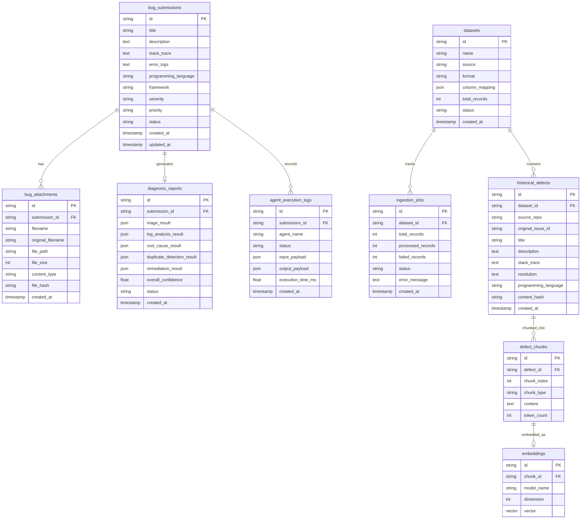

# Database Design & Entity Relationship Specification

**Platform:** Intelligent Bug Diagnosis Platform (BugDiag)  
**Database Engine:** PostgreSQL 16 with `pgvector` extension  
**ORM:** SQLAlchemy 2.0  
**Migration Manager:** Alembic  

---

## 1. Entity-Relationship (ER) Diagram

---

## 2. Table Specifications

### 1. `bug_submissions`
Stores primary defect submissions entered by engineers or QA analysts.
- `id` (VARCHAR(36), PK): UUID v4 identifier.
- `title` (VARCHAR(255), Indexed): Concise summary of the bug.
- `description` (TEXT): Full problem statement and user explanation.
- `stack_trace` (TEXT, Nullable): Raw exception stack trace or crash dump.
- `error_logs` (TEXT, Nullable): Application logs and console telemetry.
- `programming_language` (VARCHAR(64), Indexed): Detected or specified language.
- `framework` (VARCHAR(64), Indexed): Detected or specified framework.
- `severity` (VARCHAR(32), Indexed): critical | high | medium | low.
- `priority` (VARCHAR(32), Indexed): p1 | p2 | p3 | p4.
- `reproduction_steps` (TEXT, Nullable): Step-by-step reproduction instructions.
- `expected_behavior` (TEXT, Nullable): Intended behavior.
- `actual_behavior` (TEXT, Nullable): Observed failure behavior.
- `status` (VARCHAR(32), Indexed): pending | analyzing | analyzed | resolved | closed | failed.
- `created_at`, `updated_at`: UTC timestamps.

### 2. `bug_attachments`
Stores metadata and paths for non-executing uploaded log and code files.
- `id` (VARCHAR(36), PK): UUID.
- `submission_id` (VARCHAR(36), FK -> `bug_submissions.id`, CASCADE).
- `filename` (VARCHAR(255)): Sanitized disk filename.
- `original_filename` (VARCHAR(255)): Original upload filename.
- `file_path` (VARCHAR(512)): Local disk storage path.
- `file_size` (INTEGER): File size in bytes (max 10MB).
- `content_type` (VARCHAR(128)): MIME type.
- `file_hash` (VARCHAR(64), Indexed): SHA-256 integrity hash.

### 3. `datasets`
Tracks imported open-source defect repositories (Mozilla, Apache, Eclipse, etc.).
- `id` (VARCHAR(36), PK): UUID.
- `name` (VARCHAR(128), Indexed): Dataset title.
- `source` (VARCHAR(64), Indexed): Mozilla | Apache | Eclipse | Kaggle | Custom.
- `file_path` (VARCHAR(512)): Disk location of source file.
- `format` (VARCHAR(16)): csv | json.
- `column_mapping` (JSON, Nullable): User or auto-configured column mapping.
- `total_records` (INTEGER): Count of records.
- `status` (VARCHAR(32)): uploaded | processing | completed | failed.

### 4. `ingestion_jobs`
Audit trail of batch ingestion and embedding generation pipelines.
- `id` (VARCHAR(36), PK): UUID.
- `dataset_id` (VARCHAR(36), FK -> `datasets.id`, CASCADE).
- `total_records`, `processed_records`, `failed_records` (INTEGER).
- `status` (VARCHAR(32)): pending | running | completed | failed.
- `error_message` (TEXT, Nullable).

### 5. `historical_defects`
Unified representation of normalized open-source defects.
- `id` (VARCHAR(36), PK): UUID.
- `dataset_id` (VARCHAR(36), FK -> `datasets.id`, SET NULL).
- `source_repo` (VARCHAR(64), Indexed): Origin project/repo.
- `original_issue_id` (VARCHAR(64), Indexed): External ID (e.g. MOZ-1428910, SPARK-34120).
- `title` (VARCHAR(512), Indexed): Issue summary.
- `description` (TEXT): Defect details.
- `stack_trace` (TEXT, Nullable): Normalized stack trace.
- `resolution` (TEXT, Nullable): Verified fix description or patch notes.
- `status` (VARCHAR(64), Nullable): CLOSED | RESOLVED | FIXED.
- `programming_language` (VARCHAR(64), Indexed).
- `source_url` (VARCHAR(512), Nullable): Link to Bugzilla/Jira.
- `content_hash` (VARCHAR(64), Indexed): SHA-256 content deduplication hash.

### 6. `defect_chunks`
Hierarchically segmented text blocks preserving stack traces and resolutions.
- `id` (VARCHAR(36), PK): UUID.
- `defect_id` (VARCHAR(36), FK -> `historical_defects.id`, CASCADE).
- `chunk_index` (INTEGER): Sequential order.
- `chunk_type` (VARCHAR(32)): summary | description_segment | stack_trace | resolution.
- `content` (TEXT): Chunk text content.
- `token_count` (INTEGER).

### 7. `embeddings`
Dense vector embeddings stored with pgvector.
- `id` (VARCHAR(36), PK): UUID.
- `chunk_id` (VARCHAR(36), FK -> `defect_chunks.id`, CASCADE, UNIQUE).
- `model_name` (VARCHAR(128)): all-MiniLM-L6-v2.
- `dimension` (INTEGER): 384.
- `vector` (`Vector(384)` / JSON fallback on SQLite).

### 8. `diagnosis_reports`
Synthesized multi-agent diagnostic findings.
- `id` (VARCHAR(36), PK): UUID.
- `submission_id` (VARCHAR(36), FK -> `bug_submissions.id`, CASCADE, UNIQUE).
- `triage_result` (JSON): Triage Agent output.
- `log_analysis_result` (JSON): Log Analysis Agent output.
- `root_cause_result` (JSON): Root Cause Agent output.
- `duplicate_detection_result` (JSON): Duplicate Detection Agent output.
- `remediation_result` (JSON): Remediation Agent output (verified vs suggested fixes).
- `overall_confidence` (FLOAT): Calibrated 0.0 to 1.0 confidence.
- `status` (VARCHAR(32)): processing | completed | failed.

### 9. `agent_execution_logs`
Fine-grained telemetry and execution timing for each agent in the orchestration pipeline.
- `id` (VARCHAR(36), PK): UUID.
- `submission_id` (VARCHAR(36), FK -> `bug_submissions.id`, CASCADE).
- `agent_name` (VARCHAR(64), Indexed): TriageAgent, LogAnalysisAgent, etc.
- `status` (VARCHAR(32)): started | completed | failed.
- `input_payload` (JSON).
- `output_payload` (JSON).
- `execution_time_ms` (FLOAT): Duration in milliseconds.
- `error_message` (TEXT, Nullable).
