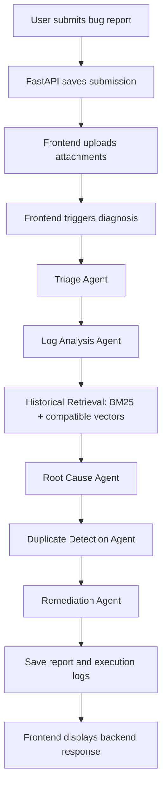

# TraceIQ System Architecture

**Current implementation:** React 18 + TypeScript frontend, FastAPI backend, SQLAlchemy database layer, and a sequential Python diagnosis pipeline.

## Request flow

## Main components

| Component | Current implementation |
|---|---|
| Frontend | React 18, TypeScript, Vite, Tailwind CSS |
| API | FastAPI, Pydantic |
| Database | SQLite for local development; PostgreSQL/pgvector supported |
| Keyword retrieval | BM25 using `rank-bm25` |
| Dense retrieval | SentenceTransformers `all-MiniLM-L6-v2` when available and compatible vectors exist |
| Retrieval fusion | Reciprocal Rank Fusion (RRF) |
| Orchestration | Sequential Python service; not LangGraph |
| Optional language model | Anthropic API when `ANTHROPIC_API_KEY` is configured |

## Five agents

1. **Triage Agent:** classifies the report, identifies likely language/framework hints, checks missing information, and calculates report completeness.
2. **Log Analysis Agent:** extracts exception information and supported stack frames from supplied logs. A detected exception alone is not treated as a parsed stack trace.
3. **Root Cause Agent:** creates a cautious hypothesis from the available evidence. Its evidence score is not a probability.
4. **Duplicate Detection Agent:** ranks historical records and flags possible duplicates using the configured relevance threshold. A relevance score is not a probability that two bugs are identical.
5. **Remediation Agent:** returns historical resolution notes and investigation guidance. It does not claim that a suggested patch has been independently applied or tested.

## Retrieval safety

- BM25 keyword retrieval is available when its dependency is installed.
- Dense search is used only when the real configured embedding model is available.
- The offline deterministic hash fallback is not semantic search and is not used to rank dense results.
- Vectors stored under a different embedding model name are not compared with the active model's vectors.
- Source and language filters are respected. If a filter has no matches, the search returns no results instead of silently searching all records.

## Submission lifecycle

The frontend creates the submission, uploads all attachments, then calls the diagnosis trigger endpoint. This order ensures the pipeline can inspect attachment contents. The backend returns a failed report status if the pipeline fails; the frontend must not replace it with a sample report.

## Important limits

TraceIQ is a decision-support tool. Its diagnosis is not guaranteed to be correct. Accuracy must be measured with labelled reports and known root causes. The included datasets are samples; always check live knowledge-base counts before stating how many records are searchable.

## Milestone 2.1 Triage Assessment

The existing TriageAgent executes first in the sequential five-agent workflow. It emits validated severity, priority, affected component, confidence, reasoning, evidence, and missing-information fields. The assessment is stored in the existing diagnosis report JSON and agent execution log; no additional pipeline or database table is created.
